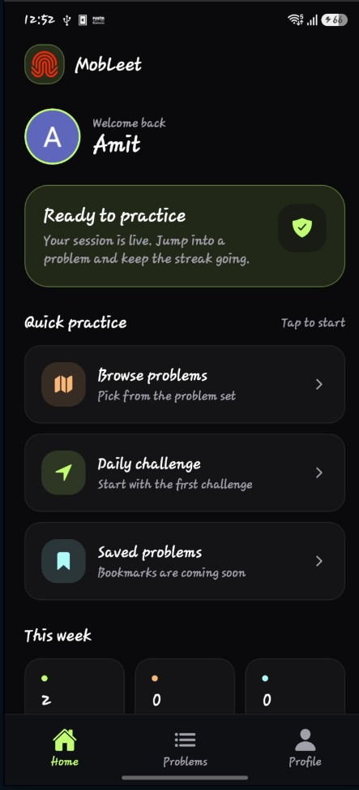
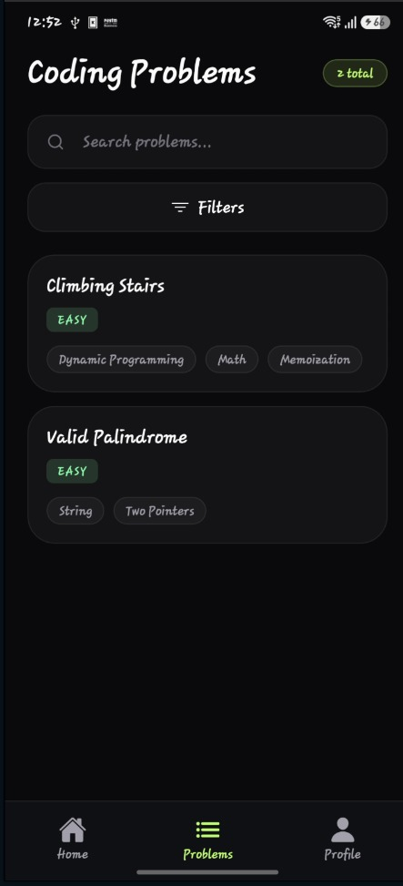
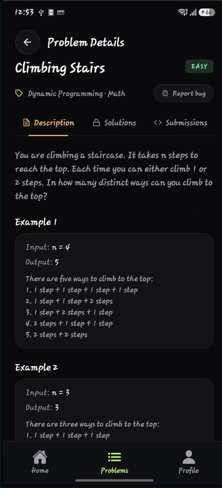
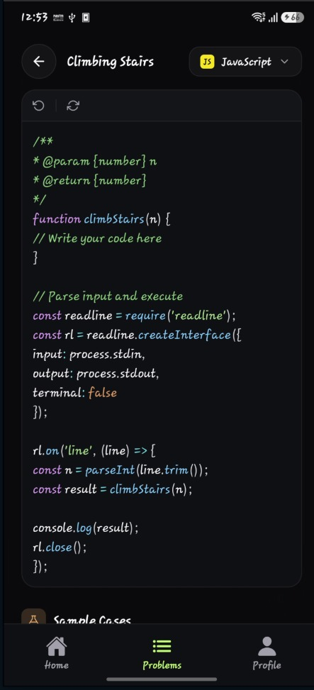
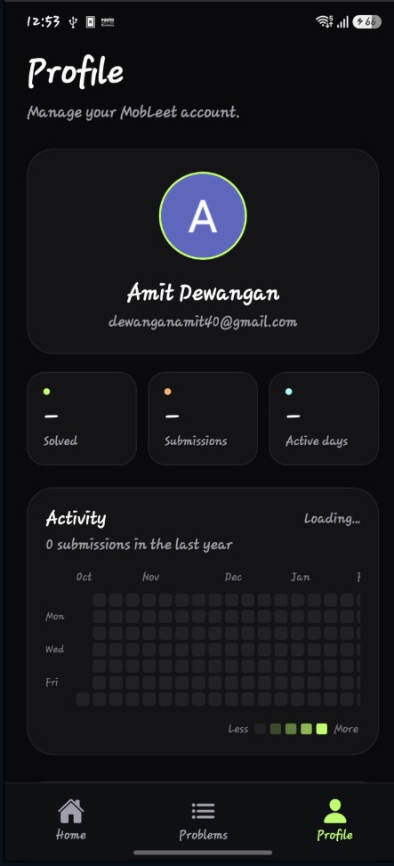

# MobLeet

**A mobile coding-practice app for solving algorithm problems wherever you are.**

MobLeet brings a focused problem library, an in-app code editor, solution judging, and personal progress tracking into one Expo app. Sign in with GitHub or Google, find a problem by title or topic, read its examples and constraints, write a solution in JavaScript, Python, or Java, and submit it to see per-test-case results.

The app is built with Expo SDK 55, React Native, Expo Router, and Supabase. Code submissions are handled by a server-side API that checks the signed-in user and delegates execution to a CodeBox-compatible judge.

## Screenshots

| Home | Browse problems |
|:--:|:--:|
|  |  |

| Problem details | Code editor |
|:--:|:--:|
|  |  |

| Profile and activity |
|:--:|
|  |

## What you can do

- **Sign in securely:** authenticate with Google or GitHub through Supabase OAuth.
- **Start from Home:** see a personalized greeting, solved count, and shortcuts to browse problems or open the first challenge.
- **Find a problem:** browse the problem set, search by title or tag, filter by Easy, Medium, or Hard, and pull to refresh.
- **Understand the challenge:** read the description, examples, constraints, and tags. Problem details also include Solutions and Submissions tabs.
- **Write and submit code:** edit starter code in the built-in editor, choose JavaScript, Python, or Java when available for the problem, inspect sample cases, and submit for judging. Results include pass/fail status and execution details.
- **Track progress:** see solved problems, submission totals, active days, and a year-long activity heatmap on your profile.

## How the app fits together

```text
Expo / React Native app
  ├── Supabase Auth ── Google and GitHub OAuth
  ├── Supabase database ── problems, submissions, solved status, activity
  └── /api/submit ── authenticated submission endpoint
                        └── CodeBox-compatible judge ── run code against test cases
```

The mobile client reads public problem data and the signed-in user's own progress from Supabase. It sends code to the app's submission API with the user's access token. The server validates the session, loads protected test cases, invokes the judge, and records the submission and results. Judge credentials and the Supabase service-role key belong on the server only; they must not be included in the mobile app's public environment variables.

## Tech stack

- Expo SDK **55** and React Native **0.83**
- TypeScript and Expo Router
- Supabase Auth and Postgres
- `expo-auth-session` and `expo-web-browser` for OAuth
- Prism.js for syntax highlighting in the code editor
- CodeBox-compatible execution API for solution judging

## Getting started

### Requirements

- Node.js **20.19.x or newer** (the minimum for Expo SDK 55)
- npm
- iOS Simulator, Android emulator, or a physical device
- A Supabase project configured with Google and/or GitHub OAuth
- A reachable MobLeet submission API and CodeBox-compatible judge to run and submit solutions

### 1. Install dependencies

```bash
git clone <repository-url>
cd Mobleet
npm install
```

### 2. Configure the app

Create a `.env` file in the project root:

```dotenv
EXPO_PUBLIC_SUPABASE_URL=https://<your-project>.supabase.co
EXPO_PUBLIC_SUPABASE_KEY=<your-supabase-publishable-or-anon-key>
EXPO_PUBLIC_API_BASE_URL=https://<your-mobleet-api-host>
```

`EXPO_PUBLIC_API_BASE_URL` is the base URL of the MobLeet API that serves `POST /api/submit`; do not add `/api/submit` to the value. For native development, this must be reachable from the device or emulator, not just from the developer's computer. In development, when this value is omitted, the app attempts to use the Expo dev server host. A hosted API URL is required in a production native build.

Only put client-safe values in `EXPO_PUBLIC_*` variables. The server that implements `/api/submit` also needs its Supabase service-role key and CodeBox settings, including `CODEBOX_API_TOKEN` and optionally `CODEBOX_EXECUTE_URL`. Never ship those server secrets in the app.

### 3. Set up Supabase

1. In Supabase Authentication, enable Google and/or GitHub and configure each provider's OAuth credentials and callback URL.
2. Add the app's OAuth redirect URI to Supabase's allowed redirect URLs. The URI is `mobleet://auth/callback` for the configured app scheme; use the redirect URI produced by the app if your platform or development build uses a different value.
3. Apply the database migration at [`src/app/supabase/20260704030004_create_problem_schema.sql`](src/app/supabase/20260704030004_create_problem_schema.sql). It creates profiles, problems, submissions, per-test-case results, solved markers, and row-level security policies.
4. Add problem content and test cases to the database. The client can display problems only when rows are present.

OAuth on iOS and Android requires a MobLeet development build. Expo Go uses an `exp://` redirect and is not supported for the configured native OAuth callback.

### 4. Start the app

```bash
npm start
```

Then press `a` to open Android, `i` to open iOS Simulator, or scan the QR code with a compatible development build. You can also use `npm run android`, `npm run ios`, or `npm run web`.

## Using MobLeet

1. Sign in with a configured identity provider.
2. Use **Home** to open the problem library or start the first available challenge.
3. In **Problems**, search for a title or tag and optionally filter by difficulty.
4. Open a problem to review its description, examples, and constraints. Use the **Submissions** tab to review your attempts. Community solutions are locked until you submit a passing answer.
5. Tap **Solve**, choose an available language, edit the starter code, and submit. The judge returns results for the problem's test cases.
6. Visit **Profile** to review solved count, submission activity, and sign out.

## Project layout

```text
src/
├── app/
│   ├── (auth)/sign-in.tsx             # OAuth sign-in screen
│   ├── (tabs)/                        # Home, problem browser, and profile
│   ├── (tabs)/problems/[id]/          # Problem details and solve/editor flow
│   ├── api/submit+api.ts              # Expo Router API endpoint
│   └── supabase/                      # Database migration and seed data
├── components/                       # Code editor and activity heatmap
├── hooks/                             # Auth and layout helpers
├── lib/                               # Supabase, auth, problem, and judge logic
└── state/                             # Auth state
assets/screens/                        # App screenshots used in this README
```

## Useful commands

| Command | Purpose |
|---|---|
| `npm start` | Start the Expo development server |
| `npm run android` | Start Expo and open Android |
| `npm run ios` | Start Expo and open iOS Simulator |
| `npm run web` | Start the web target |
| `npm run lint` | Run the configured Expo lint command |

## Current scope

The saved-problems shortcut currently routes to the problem browser; bookmarks are marked as coming soon in the app. The Home streak and saved counters are placeholders. Community solutions are locked until a passing answer is submitted. Profile submission and activity views require a signed-in account with recorded submissions.

## License

No license is currently specified in this repository. Contact the project owner before redistributing or reusing the code.
